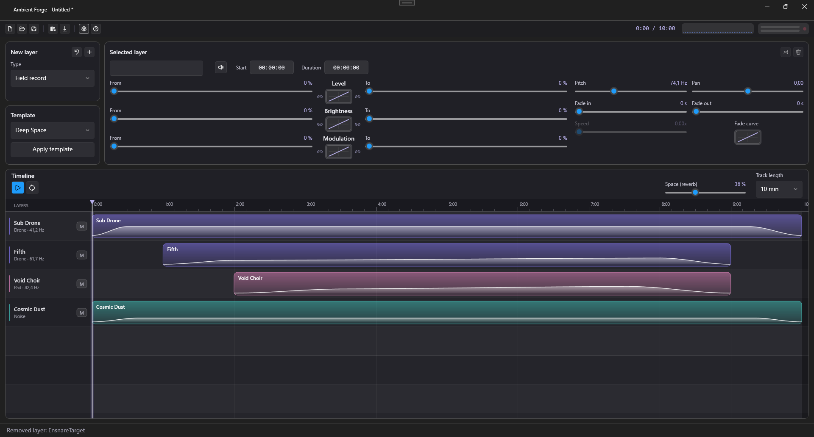
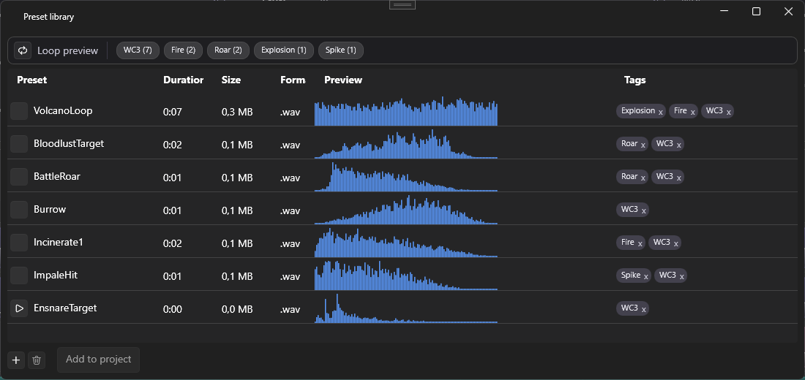

# Ambient Forge

A Windows desktop generator for **dark / space ambient** music. You build a track from layers on a timeline,
shape how each layer changes over time, listen to it live and export it to WAV or MP3.

Inspired by the sound of Mount Shrine, Alphaxone, Council of Nine, Sphare Sech and The Void Wanderer.



## What it does

- **Layers on a timeline** - drag, resize, fade in/out, reorder, mute. Types:
  - *Drone* - low sustained tones,
  - *Noise* - filtered noise textures (wind, dust),
  - *Pad* - a soft harmonic "choir",
  - *Field record* - your own recording (wav, mp3, flac...), looped and slowed down or sped up.
- **Parameters that move** - Level, Brightness and Modulation go *from -> to* over the length of a layer,
  along a chosen curve (Linear, Sine, Ease in/out, Exponential).
- **Master section** - reverb, soft limiter, spectrum and level meters, clip indicator.
- **Preset library** - a catalogue of your recordings with waveform preview, play/loop, tags and tag filter.
- **Templates and projects** - ready-made compositions, projects saved as readable `.afproj` (JSON).
- **Export** - WAV (16/32-bit) or MP3 with optional fade in/out; the same engine renders live and offline,
  so a seed always gives the same sound.
- **Controls** - sliders (default) or gauge knobs, optional "?" hints (see *Settings*).



## Run

Requires Windows and the .NET 10 SDK.

```
dotnet run --project AmbientVenGen.Desktop
```

Keys: `Space` play/stop, `Ctrl+N/O/S` new/open/save, `Ctrl+E` export, `Del` remove layer,
`Alt+Up/Down` move layer.

## Structure

| Project | Contents |
| --- | --- |
| `AmbientVenGen.Core` | Layers, project model, audio engine (generators, mixer, reverb), export, project files. No UI. |
| `AmbientVenGen.Desktop` | WPF app (WPF-UI, MVVM): timeline, inspector, preset library (SQLite), settings. |

Built with .NET 10, WPF-UI, NAudio and CommunityToolkit.Mvvm.
